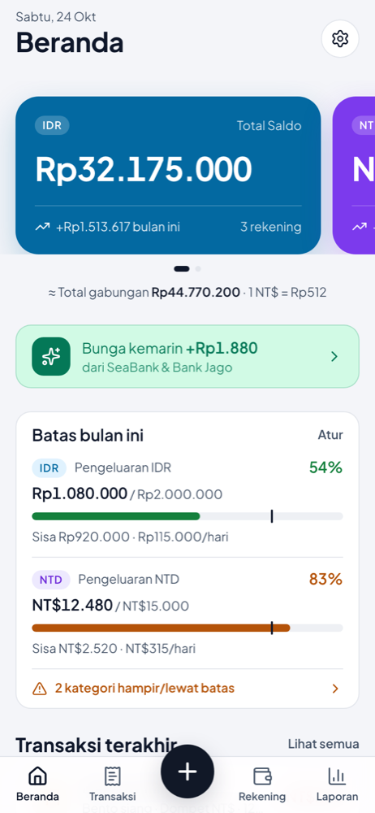
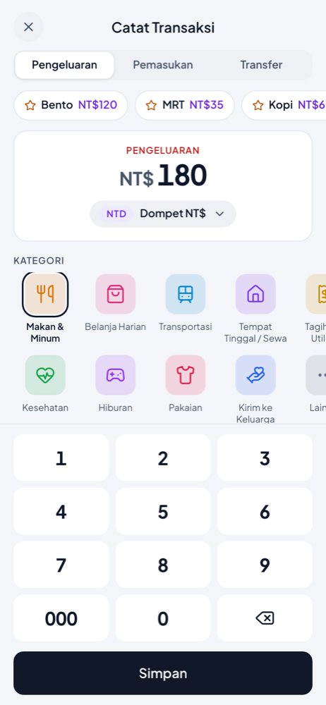
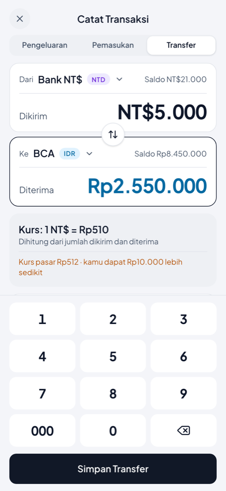
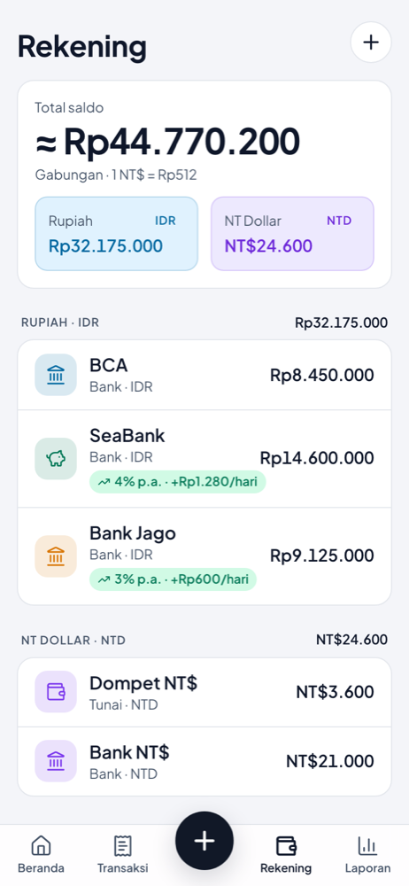
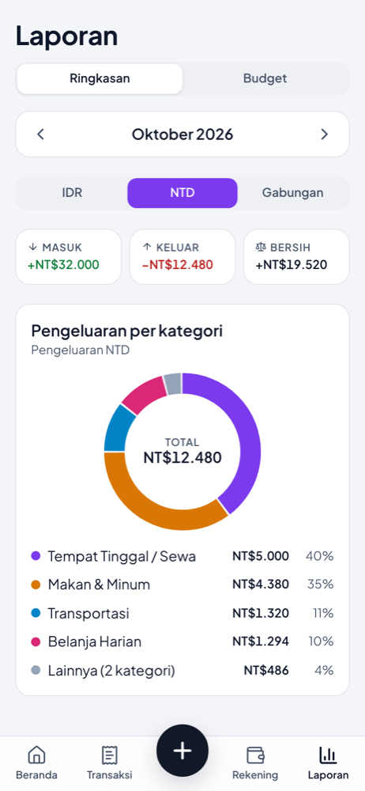
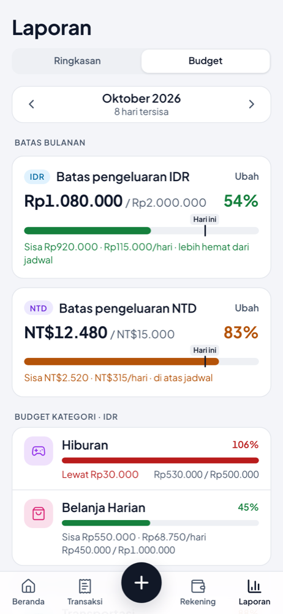
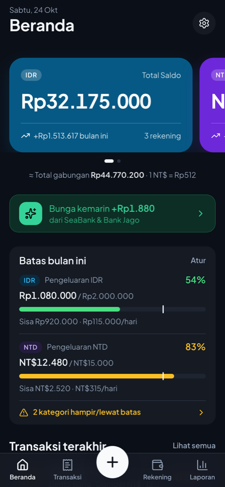

<div align="center">


# Kantong

**A local-first money manager for two currencies: Indonesian Rupiah and New Taiwan Dollar.**
Installable PWA for iPhone · works offline · no server, no account, your data never leaves the phone.

**Live:** [kantong-p1k2.vercel.app](https://kantong-p1k2.vercel.app)

[](https://github.com/latverian/kantong/actions/workflows/ci.yml)


</div>

<p align="center">
  
  
  
  
</p>
<p align="center">
  
  
  
</p>

## Why

I keep money in IDR across several Indonesian savings accounts (some pay **daily interest**) and in NTD as cash and in a bank. Existing apps handle two currencies poorly, don't compute daily interest, and store financial data on someone else's server. Kantong ("pocket" in Indonesian) solves exactly that, for one person, on one phone.

## Features (v1.0)

- **Multi-bank, multi-currency accounts:** IDR and NTD, bank / cash / e-wallet, with a combined total at your own exchange rate.
- **Fast entry:** custom keypad, last-used defaults, and **one-tap favorites** with undo. A routine expense takes 2 taps.
- **Cross-currency transfers:** the rate is derived from the amounts sent and received and compared with the market rate ("you got Rp10.000 less"). The transfer fee is booked as an expense.
- **Automatic daily interest:** per-account rate history, 20% tax above a balance threshold, daily or monthly payout, rounding with carried remainders, and **full recomputation when a past transaction is edited**.
- **Monthly limits & category budgets:** an ideal-pace marker on every bar, "remaining per day", and alerts at 80% / 100% (once per month).
- **Reconcile balance** against the real bank balance (booked as an adjustment, excluded from reports).
- History with filters and search, a monthly report with a donut chart, dark mode, and an opening animation.
- **Backup / restore** (validated JSON) and CSV export through the iOS share sheet.

## Engineering highlights

| Area | What's interesting |
|---|---|
| **Local-first** | All data lives in IndexedDB (Dexie). One live query feeds the whole UI; pure functions derive balances, flows and limits. |
| **Interest engine** | [`src/lib/interest.ts`](src/lib/interest.ts) is pure and idempotent: incremental day-by-day accrual, carry-forward rounding, rate history, and a `dirtyFrom` flag that triggers a full recompute while keeping manual edits. |
| **Money correctness** | Integer minor units (×100), floor-rounded progress percentages, largest-remainder rounding for chart legends. The rules live in one place ([PRD §6](PRD.md#6-aturan-hitung)) and are unit-tested. |
| **Security** | Strict CSP (only `'self'`; the one inline style is allowed by SHA-256 hash), HSTS, `frame-ancestors 'none'`, Permissions-Policy, validated restore. Headers are **generated at build time** for Cloudflare, Netlify and Vercel from a single list ([`vite.security.ts`](vite.security.ts)). An **attack simulation runs in CI** (stored XSS, exfiltration, inline script, eval, clickjacking). See [SECURITY.md](SECURITY.md). |
| **Design process** | Spec first ([PRD.md](PRD.md)), then a design system ([DESIGN.md](DESIGN.md), linted with `@google/design.md`), then 21 screens generated in Google Stitch via its MCP API ([STITCH-PROMPTS.md](STITCH-PROMPTS.md)), then code that matches the designs number for number. |
| **PWA on iOS** | Standalone mode, safe areas, 16px inputs (no zoom), a static first frame plus an animated intro, persistent-storage request, and auto-updating service worker. |

## Tech stack

React 19 · TypeScript · Vite 7 · Tailwind CSS 4 · Dexie (IndexedDB) · React Router (HashRouter) · vite-plugin-pwa / Workbox · Vitest · Playwright · lucide icons · self-hosted Plus Jakarta Sans. Charts are hand-written SVG (no chart library).

## Getting started

```bash
npm install
npm run dev            # http://localhost:5173 — tap "Coba dengan data contoh" for sample data
npm test               # unit tests (interest, ledger, limits, backup validation)
npm run build          # production build in dist/ (+ _headers, robots.txt, vercel.json check)
```

Security checks:

```bash
npx playwright install chromium   # once
npm run build && npm run serve:secure   # dist/ with the real headers on :4174
npm run test:attack                     # 12 checks: headers, XSS, exfiltration, eval, clickjacking
npm run audit
```

## Project structure

```
src/
  db/          data model, Dexie schema, default categories
  lib/         pure logic: ledger, interest, limits, money, dates · ops (all writes) · backup · demo data
  state/       DataProvider (whole DB as one live query) and toasts
  components/  UI primitives that follow DESIGN.md
  screens/     one file per screen
scripts/       icon generator, header-aware static server, attack simulation
design/        Stitch screens (PNG + HTML) and the logo source
docs/          README screenshots
```

## Deployment

Static hosting only. `dist/` contains everything, including the security headers for each host:

- **Vercel:** import the repo; `vercel.json` (generated and verified by the build) sets the headers.
- **Cloudflare Pages / Netlify:** upload `dist/`; they read `dist/_headers`.

Then open the URL in Safari on the iPhone → Share → **Add to Home Screen**.

## Documentation (Bahasa Indonesia)

- [PRD.md](PRD.md): product requirements, calculation rules, sample data
- [DESIGN.md](DESIGN.md): design system (tokens, components, do's & don'ts)
- [STITCH-PROMPTS.md](STITCH-PROMPTS.md): screen prompts and Stitch screen IDs
- [SECURITY.md](SECURITY.md): threat model, every defence explained, how to test it yourself

## Roadmap (v1.1)

Savings goals · scheduled transactions & bills · debts / receivables · cash counter · net-worth chart · automatic exchange rate · quick-open · hide balances · Calendar reminders · encrypted backups.
